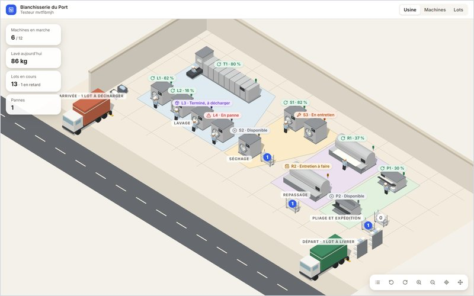
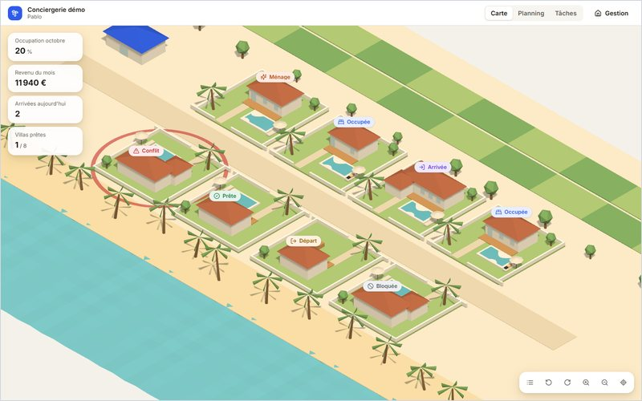
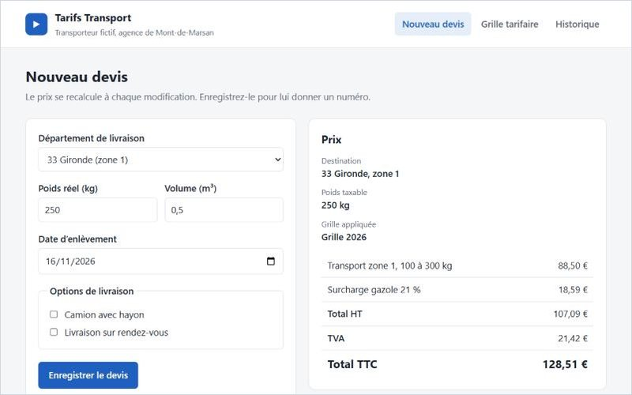
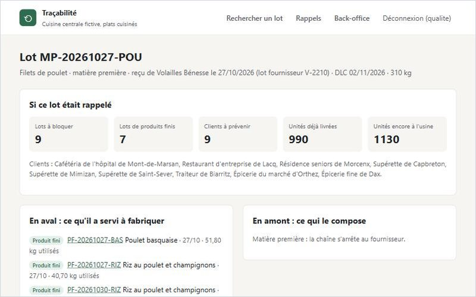
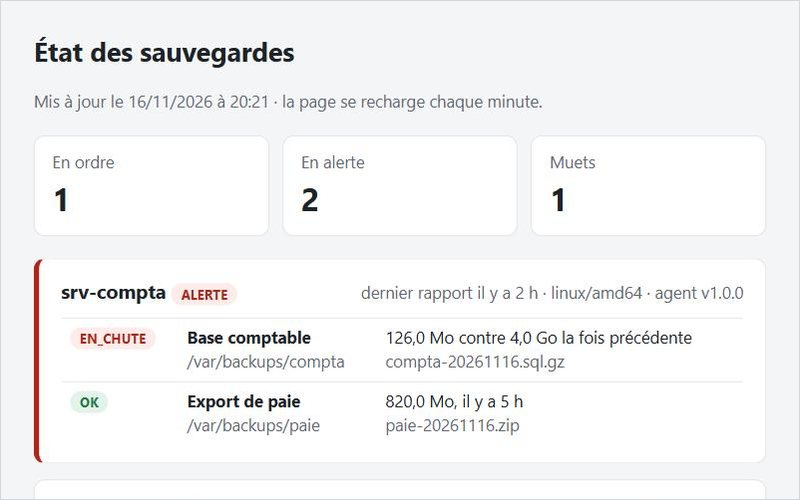
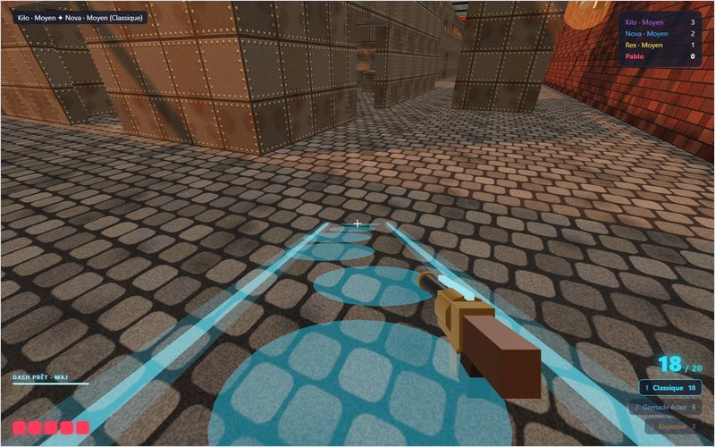

<h1 align="center">Pablo Marin</h1>

  <b>Full-stack developer · Engineer, IMT Mines Alès · Eight years running my own companies</b> 
  Basque Country, France

  
  
  

### Hi there 👋

**A rare profile: engineer, company founder for eight years, full-time developer. I know why we build, and I can build it.**

- 🎓 Engineering degree from **IMT Mines Alès**. Twice winner of the IMT pitch contest, fellow of the Institut de l'Engagement.
- 🏭 For eight years I ran my own industrial companies, with the P&L in my hands: product design, industrialisation, production, around fifteen subcontractors.
- 🛠️ Today I design, build and deploy complete products on my own: business software, 3D interfaces, real-time multiplayer, computer vision.
- 🌍 French (native), English (professional), Spanish. Open to remote work and to employers abroad.
- 📫 How to reach me: [LinkedIn](https://www.linkedin.com/in/pablo-marin-/) · [contact@pablomarin.fr](mailto:contact@pablomarin.fr)

### 🚀 Featured projects

<table>
<tr>
<td width="50%" valign="top">

**Industrial laundry operations** 
The plant in 3D with the live state of every machine. Lots tracked through each step, breakdowns, delivery priorities and team planning. 
React · Three.js · Hono · Cloudflare Workers · D1 · Playwright 
🔒 Private code · [Live demo ↗](https://crm-blanchisserie.tinyfungi-eco.workers.dev), sign in with any first name

</td>
<td width="50%" valign="top">

**Villa concierge CRM** 
The home screen is an isometric 3D map of the villa portfolio: occupancy, arrivals, cleaning and maintenance tickets, owner statements, iCal calendar sync. 
React · Three.js · Hono · Cloudflare Workers · D1 · Playwright 
🔒 Private code · demo on request

</td>
</tr>
<tr>
<td width="50%" valign="top">

**[tarifs-transport](https://github.com/brakan1337/tarifs-transport)** 
Pricing engine for a parcel carrier: dated rate grids, volumetric weight, minimum charge, fuel surcharge and options. A detailed quote, to the cent. 
Java 21 · Spring Boot 4 · PostgreSQL · Flyway · Angular · JUnit · Docker 

</td>
<td width="50%" valign="top">

**[rappel-lots](https://github.com/brakan1337/rappel-lots)** 
Lot traceability and recall for a central kitchen. A recursive SQL query walks the lot graph, a recall blocks everything downstream, and the warehouse API refuses to ship a blocked lot. 
Python · Django · Django REST Framework · PostgreSQL · pytest · Docker 

</td>
</tr>
<tr>
<td width="50%" valign="top">

**[veille-sauvegardes](https://github.com/brakan1337/veille-sauvegardes)** 
Every morning, a managed-services provider knows which client backups failed overnight and which servers went silent. Go agent and collector with no dependency, one AWS collector per client in Terraform, Bash installer under systemd. 
Go · Terraform · AWS · Bash · systemd · GitHub Actions 

</td>
<td width="50%" valign="top">

**Tracer** 
Real-time multiplayer FPS where every bullet leaves a walkable bridge of light. Authoritative server, bots, co-op survival mode, VR players alongside PC players. 
Node.js · WebSocket · Three.js · WebXR · Cloudflare Durable Objects 
🔒 Private code · [Play it ↗](https://tracer.tinyfungi-eco.workers.dev)

</td>
</tr>
</table>

### 🧩 More I've built

- **Capusine**: a business-management serious game for business schools. Its simulation engine is pure and deterministic, kept apart from the interface: same inputs, same world for every team. React · Hono · Cloudflare Workers · D1
- **Running gait analysis**: joint angles from a running video, frame by frame, computed in the browser by a pose model. The video never leaves the device. TypeScript · MediaPipe · [Try it ↗](https://analyse-foulee.tinyfungi-eco.workers.dev)
- **Verzane**: team scheduling for small businesses, with positions, skills and time slots. React · Hono · Cloudflare Pages · D1 · [verzane.pages.dev ↗](https://verzane.pages.dev)
- **Défi Bleu contre Rouge**: a two-team running challenge with Google sign-in and Strava links. Cloudflare Workers · D1 · [Live ↗](https://defi-bleu-rouge.tinyfungi-eco.workers.dev) · [Code](https://github.com/brakan1337/defi-bleu-rouge)
- **Language-learning apps**: Android apps in React Native (Expo) on a home-made spaced-repetition engine. Content and progress are decoupled, so new content never erases a learner's history. Web versions: [Basque](https://brakan1337.github.io/mon-basque-web/) · [Japanese](https://brakan1337.github.io/mon-japonais-web/) · [Moroccan Arabic](https://brakan1337.github.io/mon-arabe-web/)
- **Multi-source aggregation and scoring engine**: twelve APIs in, deduplication, weighted scoring configured in YAML, about 4,500 records a day. Python
- **[prospection-scraper](https://github.com/brakan1337/prospection-scraper)**: B2B prospecting from OpenStreetMap and the SIRENE register, with published e-mails, website audit and CSV export. Python

### 🛠️ Languages and tools

**Languages** 
<picture><source media="(prefers-color-scheme: dark)" srcset="assets/langages-dark.svg"></picture>

**Frameworks** 
<picture><source media="(prefers-color-scheme: dark)" srcset="assets/frameworks-dark.svg"></picture>

**Data, infrastructure and tooling** 
<picture><source media="(prefers-color-scheme: dark)" srcset="assets/donnees-infra-dark.svg"></picture>

Also: LLM integration and agents · computer vision (MediaPipe) · ETL and scraping · pandas · ffmpeg · JUnit · pytest · Vitest · Playwright

### ⚙️ How I work

- Business rules live in pure, deterministic engines, kept apart from the interface and tested on their own.
- Each portfolio repo starts from a written brief that justifies its technical choices.
- I deploy what I write, and I fix it when it breaks.

---

Most of my product code is private. I'm happy to walk you through any of it.
